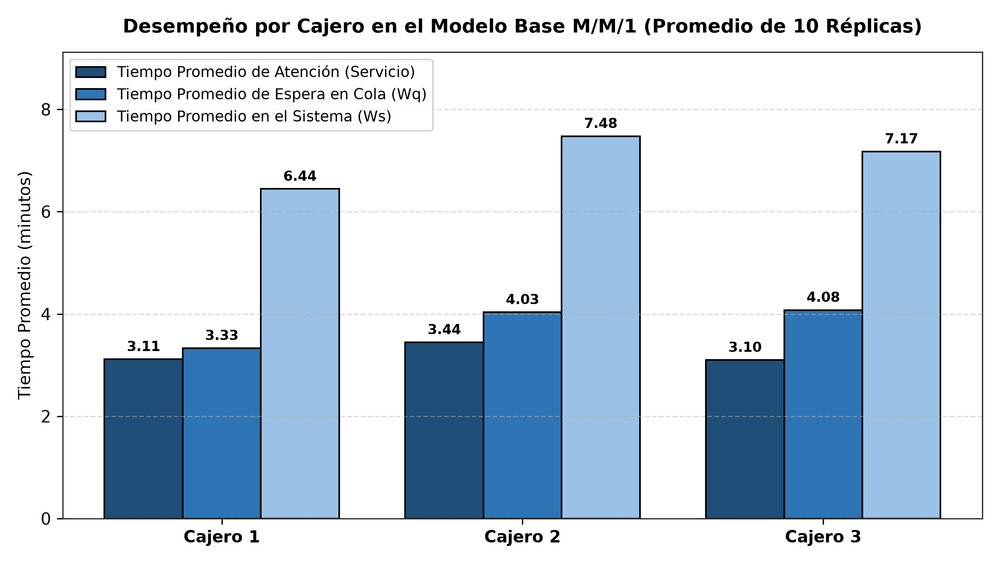
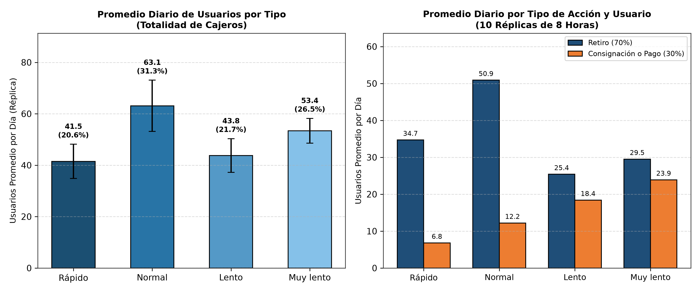
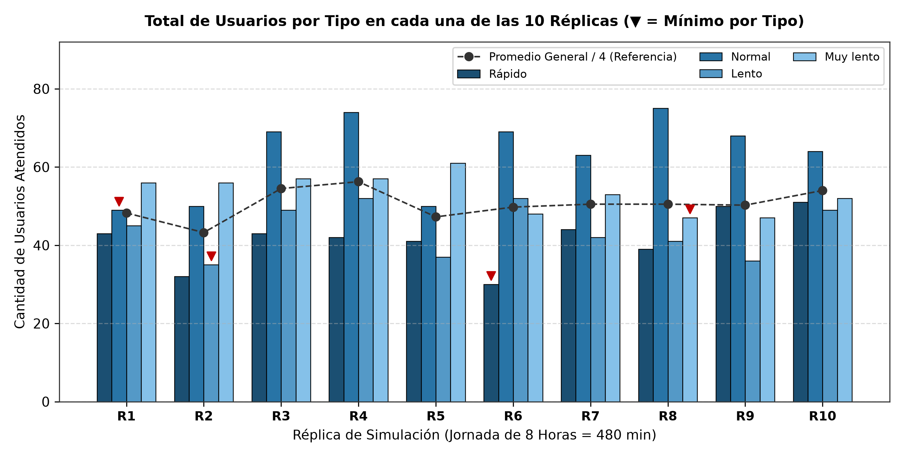
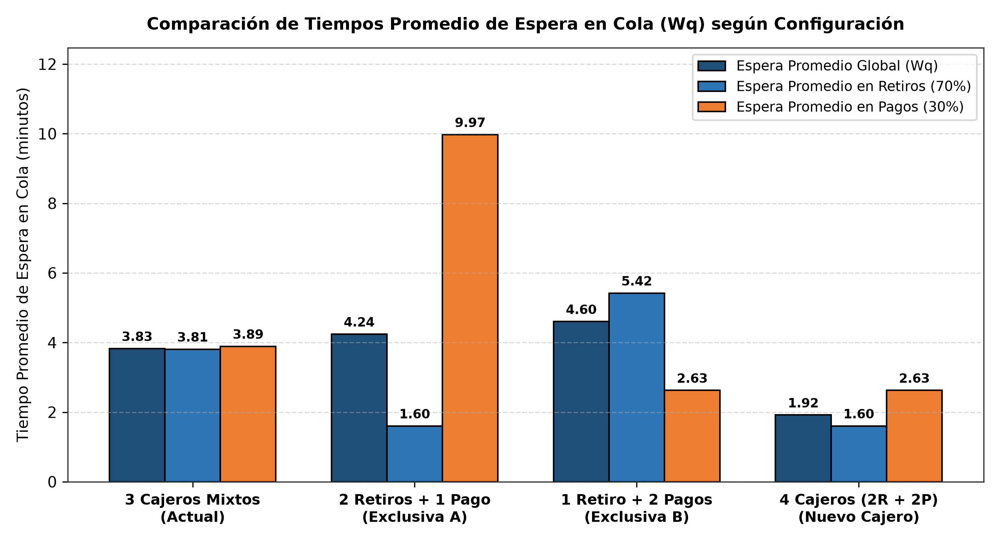

# Simulación de un Problema Bancario con Modelos de Colas M/M/1

**Actividad Didáctica 2-M3 – Simulación (PREICA2602B020045)**  
**Institución Universitaria Digital de Antioquia**  
**Docente:** Julián Andrés Loaiza  

### Integrantes (Grupo 3)
* **Raul Santiago Morales Henao**
* **David Octavio Castro Mora**
* **Claudia Dilbani Enriquez Botina**

**Repositorio Oficial:** [https://github.com/shenao356/simulacion_bancos](https://github.com/shenao356/simulacion_bancos)  
**Cuaderno en Google Colab (Drive):** [https://drive.google.com/file/d/19xGjI0yKWbCut78gRfiteJCNipN4NbfO/view?usp=sharing](https://drive.google.com/file/d/19xGjI0yKWbCut78gRfiteJCNipN4NbfO/view?usp=sharing)  
**Ejecutar en Google Colab sincronizado con GitHub:** [](https://colab.research.google.com/github/shenao356/simulacion_bancos/blob/main/Morales_Henao_Santiago_Grupo3_Banco_MM1.ipynb)

---

## 1. Descripción del Problema

El **Banco de Colombia** busca medir y optimizar el desempeño de sus tres cajeros físicos durante las operaciones de **retiros (70 % de los usuarios)** y **consignaciones o pagos (30 % de los usuarios)** en una jornada diaria de **8 horas (480 minutos)**. Cada cajero opera de manera independiente bajo la estructura de un modelo de colas **M/M/1** (llegadas de Poisson / tiempos entre llegadas exponenciales, tiempos de servicio exponenciales, un servidor por cola independiente, disciplina FIFO, atención inmediata al estar libre y velocidad de desplazamiento despreciable).

A través de **10 réplicas (corridas independientes)** aplicando la técnica de **Números Aleatorios Comunes (CRN)**, este proyecto resuelve los cinco puntos planteados en la guía:
1. Identificación del cajero con **menor y mayor tiempo promedio de atención** (sin segregar usuarios).
2. Cálculo del **promedio de usuarios de cada tipo** en la totalidad de cajeros.
3. Determinación del **total de usuarios de cada tipo en cada una de las 10 réplicas** y detalle del modelo/corrida con menor cantidad de usuarios por tipo.
4. Evaluación mediante datos sobre si es necesario **crear un nuevo cajero (o cajero electrónico)** utilizando los tiempos promedio de espera en cola ($W_q$) en todos los criterios del modelo.
5. Decisión fundamentada sobre **cuántos cajeros deben ofrecer atención exclusiva para pagos y cuántos para retiros** (`2 Retiros + 1 Pago` vs. `1 Retiro + 2 Pagos`).

---

## 2. Parámetros del Modelo (Tablas 1 y 2)

| Tipo de acción | Proporción global | Tipo de usuario | Probabilidad condicional | Probabilidad global | Media exponencial de servicio (min) | Media exponencial de llegada (min) |
| :--- | :---: | :--- | :---: | :---: | :---: | :---: |
| **Retiro** | 70 % | Rápido | 0,23 | 16,10 % | 1,0 | 1,0 |
| **Retiro** | 70 % | Normal | 0,40 | 28,00 % | 2,0 | 2,0 |
| **Retiro** | 70 % | Lento | 0,17 | 11,90 % | 3,0 | 3,0 |
| **Retiro** | 70 % | Muy lento | 0,20 | 14,00 % | 4,0 | 3,0 |
| **Consignación o pago** | 30 % | Rápido | 0,10 | 3,00 % | 3,0 | 1,0 |
| **Consignación o pago** | 30 % | Normal | 0,20 | 6,00 % | 3,0 | 2,0 |
| **Consignación o pago** | 30 % | Lento | 0,30 | 9,00 % | 5,0 | 3,0 |
| **Consignación o pago** | 30 % | Muy lento | 0,40 | 12,00 % | 7,0 | 4,0 |

---

## 3. Estructura del Repositorio

```text
├── simulacion_banco_mm1.py                         # Script principal de simulación M/M/1, exportación CSV y gráficas
├── Morales_Henao_Santiago_Grupo3_Banco_MM1.ipynb   # Cuaderno Jupyter / Google Colab ejecutado con todas las salidas
├── requirements.txt                                # Dependencias de Python
├── README.md                                       # Documentación e instrucciones de ejecución
└── resultados/                                     # Evidencias numéricas (CSV) y gráficas de alta resolución (300 DPI)
    ├── detalle_corridas_mm1.csv
    ├── punto1_cajeros.csv
    ├── punto2_tipo_usuario.csv
    ├── punto2_8categorias.csv
    ├── punto3_replicas.csv
    ├── punto3_8cat_replicas.csv
    ├── punto4_5_escenarios_global.csv
    ├── punto4_5_escenarios_cajero.csv
    └── graficas/
        ├── fig1_tiempos_por_cajero.png
        ├── fig2_promedio_usuarios_tipo.png
        ├── fig3_usuarios_por_replica.png
        └── fig4_comparacion_escenarios_espera.png
```

---

## 4. Instrucciones de Ejecución

### Requisitos previos
* Python 3.9 o superior.
* Clonar el repositorio e instalar las librerías listadas en `requirements.txt`:

```bash
git clone https://github.com/shenao356/simulacion_bancos.git
cd simulacion_bancos
pip install -r requirements.txt
```

### Ejecución del script de simulación
Para ejecutar las 10 réplicas de los modelos M/M/1, imprimir las tablas estadísticas en consola y regenerar todos los archivos `.csv` y gráficas `.png` en la carpeta `resultados/`:

```bash
python simulacion_banco_mm1.py
```

### Ejecución en Google Colab / Jupyter Notebook
Puede visualizar el cuaderno `Morales_Henao_Santiago_Grupo3_Banco_MM1.ipynb` con todas sus salidas y gráficas ya ejecutadas directamente desde este repositorio en GitHub, o abrirlo interactivamente en **Google Colab** mediante cualquiera de los siguientes enlaces:
* **Abrir en Google Colab sincronizado con GitHub:** [https://colab.research.google.com/github/shenao356/simulacion_bancos/blob/main/Morales_Henao_Santiago_Grupo3_Banco_MM1.ipynb](https://colab.research.google.com/github/shenao356/simulacion_bancos/blob/main/Morales_Henao_Santiago_Grupo3_Banco_MM1.ipynb)
* **Abrir en Google Colab desde Google Drive:** [https://drive.google.com/file/d/19xGjI0yKWbCut78gRfiteJCNipN4NbfO/view?usp=sharing](https://drive.google.com/file/d/19xGjI0yKWbCut78gRfiteJCNipN4NbfO/view?usp=sharing) (o acceso directo: [https://colab.research.google.com/drive/19xGjI0yKWbCut78gRfiteJCNipN4NbfO](https://colab.research.google.com/drive/19xGjI0yKWbCut78gRfiteJCNipN4NbfO))

---

## 5. Síntesis de Resultados Principales (10 Réplicas de 8 Horas)

### 5.1. Cajero con menor y mayor tiempo promedio de atención (Punto 1)
En el **Modelo Base (3 Cajeros Mixtos M/M/1)** sin segregar usuarios:
* **Menor tiempo promedio de atención:** **Cajero 3** con **3,10 minutos** (3,09 min ponderado global; 70,1 usuarios/día; utilización del 45,09 %).
* **Tiempo intermedio de atención:** **Cajero 1** con **3,11 minutos** (66,0 usuarios/día; utilización del 42,74 %).
* **Mayor tiempo promedio de atención:** **Cajero 2** con **3,44 minutos** (3,40 min ponderado global; 65,7 usuarios/día; utilización del 46,58 %).



### 5.2. Promedio de usuarios de cada tipo en la totalidad de cajeros (Punto 2)
Sobre un total de **2.018 usuarios** atendidos en las 10 réplicas (**201,80 usuarios/día** en promedio):
* **Rápido:** **41,50 usuarios/día** ($DE = 6,69$; 20,56 % empírico vs. 19,10 % teórico).
* **Normal:** **63,10 usuarios/día** ($DE = 9,98$; 31,27 % empírico vs. 34,00 % teórico).
* **Lento:** **43,80 usuarios/día** ($DE = 6,55$; 21,70 % empírico vs. 20,90 % teórico).
* **Muy lento:** **53,40 usuarios/día** ($DE = 4,84$; 26,46 % empírico vs. 26,00 % teórico).
* **Por tipo de acción:** **140,50 usuarios/día en Retiros** (69,62 %) y **61,30 usuarios/día en Consignaciones o pagos** (30,38 %).



### 5.3. Total de usuarios por réplica y menor cantidad por tipo (Punto 3)

| Réplica | Rápido | Normal | Lento | Muy lento | Total Réplica | Retiros (70%) | Pagos (30%) |
| :---: | :---: | :---: | :---: | :---: | :---: | :---: | :---: |
| **1** | 43 | **49 (Mín.)** | 45 | 56 | 193 | **126 (Mín.)** | 67 |
| **2** | 32 | 50 | **35 (Mín.)** | 56 | **173 (Mín. Global)** | 130 | **43 (Mín.)** |
| **3** | 43 | 69 | 49 | 57 | 218 | 160 | 58 |
| **4** | 42 | 74 | 52 | 57 | 225 | 157 | 68 |
| **5** | 41 | 50 | 37 | 61 | 189 | **126 (Mín.)** | 63 |
| **6** | **30 (Mín.)** | 69 | 52 | 48 | 199 | 139 | 60 |
| **7** | 44 | 63 | 42 | 53 | 202 | 140 | 62 |
| **8** | 39 | 75 | 41 | **47 (Mín.)** | 202 | 137 | 65 |
| **9** | 50 | 68 | 36 | **47 (Mín.)** | 201 | 141 | 60 |
| **10** | 51 | 64 | 49 | 52 | 216 | 149 | 67 |
| **Total** | **415** | **631** | **438** | **534** | **2.018** | **1.405** | **613** |
| **Promedio** | **41,50** | **63,10** | **43,80** | **53,40** | **201,80** | **140,50** | **61,30** |

* **Réplica con menor volumen total:** **Réplica 2** con **173 usuarios** (y menor volumen de usuarios Lentos con 35 y de Pagos con 43).
* **Menores registros por tipo:** Rápido en **Réplica 6** (30 usuarios); Normal en **Réplica 1** (49 usuarios); Lento en **Réplica 2** (35 usuarios); Muy lento en **Réplicas 8 y 9** (47 usuarios).



### 5.4. Evaluación de nuevo cajero y asignación exclusiva (Puntos 4 y 5)

| Escenario Evaluado | Espera Global $W_q$ (min) | Espera en Retiros (min) | Espera en Pagos (min) | Tiempo en Sistema $W_s$ (min) | Espera Máxima Prom. (min) |
| :--- | :---: | :---: | :---: | :---: | :---: |
| **3 Cajeros Mixtos (Actual)** | 3,83 | 3,81 | 3,89 | 7,03 | 33,86 |
| **2 Retiros + 1 Pago (Exclusiva A)** | **4,24** | **1,60** | 9,97 | **7,45** | 40,70 |
| **1 Retiro + 2 Pagos (Exclusiva B)** | 4,60 | 5,42 | **2,63** | 7,81 | 28,92 |
| **4 Cajeros: 2R + 2P (Nuevo Cajero)** | **1,92** | **1,60** | **2,63** | **5,12** | **23,69** |

1. **Decisión de exclusividad con 3 cajas (Punto 5):** Entre las dos opciones de dedicación exclusiva, **se deben asignar 2 cajeros exclusivos para Retiros y 1 cajero exclusivo para Pagos (`2R + 1P`)**, dado que obtiene un menor tiempo promedio de espera global (**4,24 min vs. 4,60 min**) y reduce la espera del **70 % de los usuarios (Retiros)** a tan solo **1,60 minutos** (frente a 5,42 min en `1R + 2P`).
2. **Necesidad y viabilidad de un nuevo cajero / cajero electrónico (Punto 4):** Aunque con 3 cajas el sistema es matemáticamente estable ($\rho < 1$), cualquier partición exclusiva de 3 cajas genera un cuello de botella en el servicio con 1 sola caja (**9,97 min de espera en pagos** bajo `2R + 1P`, con $\rho = 66,08\%$; o **5,42 min de espera en retiros** bajo `1R + 2P`, con $\rho = 68,33\%$). Al incorporar **un nuevo cajero (4.º módulo o cajero electrónico/ATM)** bajo un esquema **2 Retiros + 2 Pagos**, el tiempo de espera global cae a **1,92 minutos** (**reducción del 49,9 % respecto al modelo mixto y del 54,8 % respecto a 2R+1P**), eliminando por completo las demoras críticas.


